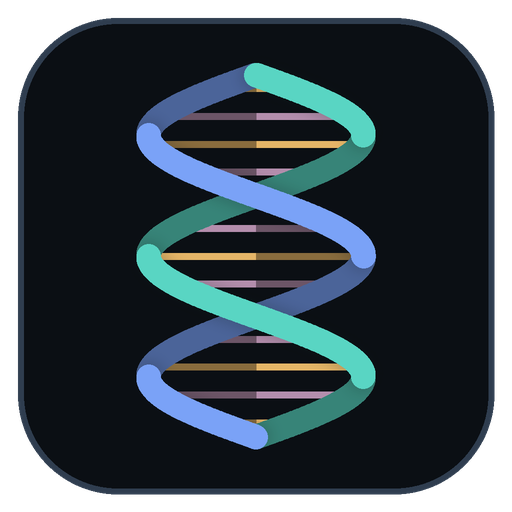

<div align="center">



# Gene OS

**A terminal-driven research operating environment for animal breeding & genetics.**

Boots like an OS, puts a real shell at the center of a bento desktop, and gives a graduate researcher one place for thesis work, courses, papers, programs and a validated quantitative-genetics toolbox. Everything runs locally on Windows.


-0B0F14?style=flat-square&labelColor=151D27&color=98C379)


[Features](#features) · [Screenshots](#screenshots) · [Install](#installation) · [Usage](#usage) · [Terminal](docs/TERMINAL.md) · [Tools](docs/TOOLS.md) · [Build](docs/BUILD.md) · [Contributing](CONTRIBUTING.md)

</div>

---

## Why Gene OS?

Research in animal breeding jumps between SAS/R/BLUPF90 runs, a thesis proposal, course material, a pile of PDFs and a dozen calculators. Gene OS puts all of that in one environment you can drive from the keyboard. Your data stays on your own machine, with no accounts, cloud or telemetry.

## Features

### 🖥️ An OS-style environment
- **Boot sequence**: a POST screen with your real CPU, memory and storage, then the Gene OS logo with an animated DNA helix while the modules load (with a progress bar). Press any key to skip.
- **Login / lock screen**: a large clock, your avatar and name, and an optional **PIN**. Lock any time with `Ctrl+Alt+L`.
- **Grouped dock**: Home · Status | **Work** (Tasks, Research, Courses, Notes) | **Knowledge** (Library, Bookmarks) | **System** (Apps, Terminal, Tools), plus your profile chip. Each module has its own icon and accent color, and a page header with a breadcrumb.
- **Status bar**: system, storage, active project, clock, session time, pomodoro and version.

### 🧩 Home: a customizable bento desktop
The **gsh terminal** sits in the center, surrounded by: a researcher card (click it to open the profile), a live **system overview** (CPU sparkline, memory, disk, app memory, DB), an **app launcher**, **pending tasks** with quick-add, a **progress tracker** (proposal, timeline, checklist, focus goal, courses), **quick shortcuts**, **recent** files/notes/projects, **deadlines** and a **focus / pomodoro** ring. You can also add a **quick note**, a **mini calendar** and **bookmarks**.
- **Customize** (the ⊞ button, `home edit`, or Settings → Behavior): choose a layout (Balanced · Terminal · Widgets · Focus), then drag a widget's header onto another to swap them or pick one from each slot's menu. Every layout remembers its own arrangement.

### ⌨️ gsh: the Gene OS shell
- **Prompt**: powerline-style, with live syntax highlighting, grey history suggestions (accept with `→`), Tab completion for commands, sub-commands, paths, apps and tool ids, and a duration plus ✔/✘ marker on every command.
- **Shell features**: pipes (`| grep | head | tail | sort | uniq | wc | nl`), chaining (`;`, `&&`), history expansion (`!!`, `!n`, `!prefix`) and aliases.
- **Virtual filesystem**: browse your data as folders with `cd ~/research/msc-thesis`, `ls -l`, `cat 02-abstract`, `tree` and `open .`.
- **`gfetch`**: a neofetch-style report with Gene OS's own helix logo. It covers OS, kernel, CPU, GPU, memory, disk, display, runtime, database, apps, tools, projects, tasks and library.
- **More commands**: `top`, `uptime`, `dna revcomp|translate|gc|orf|random|helix`, `cal`, `timer`, `export`, `lock`, `reboot`, `tip`, `which`, `prompt`, and nearly 100 commands (plus aliases) that drive the same services as the interface. → [docs/TERMINAL.md](docs/TERMINAL.md)

### 🧬 Science toolbox: 63 calculators and 5 workspaces
- **Areas covered** (63 calculators): quantitative genetics, population genetics, genomics & sequence, breeding & selection, animal science, statistics and utilities. → [docs/TOOLS.md](docs/TOOLS.md)
- **Workspaces**: **animal-model BLUP** (verified against Mrode Example 3.1) with **REML variance components** (fast profile likelihood with standard errors and a likelihood plot, or EM; checked against an independent NumPy solution), pedigree viewer with the A-matrix, Hazel selection index, inbreeding-aware mating planner and a selection-decision workspace.
- **Tools home**: categories, favorites, most used and recent runs.
- **On every tool**: Load example, Reset to defaults, Calculate & save to **history**, Copy, and Export to **CSV / Markdown / JSON / Notes**. Decimal places and live calculation are configurable.

### 📚 Research & study
- **Tasks**: list, kanban, calendar, today, upcoming, overdue, completed and priority-matrix views. Also subtasks, recurrence, reminders, templates, a time tracker and a pomodoro.
- **Research**: a 16-section proposal editor with autosave and version history, a Gantt timeline with dependencies, a thesis checklist and a literature matrix.
- **Courses**: separate workspaces with notes, lectures, assignments, topics, files, a reading list and Leitner flashcards.
- **Library**: files are linked (your originals are never touched) or copied in, with SHA-256 duplicate detection, metadata, previews, paper reviews and citations.
- **Notes & bookmarks**: Markdown notes with `[[links]]`, daily and research journals, a scratchpad, snippets, clipboard history, and bookmarks with browser import/export.

### 🇮🇷 Calendar & region
- **Jalali (Solar Hijri) dates** alongside Gregorian ones on Home, the task calendar, the lock screen and in `cal -j`.
- **Conversion**: `jdate`, or the Date converter tool (with date differences and adding days).
- **Week start**: Saturday, Sunday or Monday.
- **Iranian work-week (Sat–Wed) repeat rule** for tasks.

### 🪟 Windows apps
- **Registering**: add `.exe` / `.lnk` files by dialog or drag & drop. Shortcut targets, arguments and working folders are resolved automatically.
- **Icons**: extracted reliably from shortcut icon locations, including `%SystemRoot%` paths, icon indices and MSI-advertised shortcuts.
- **Overview page**: clicking an app opens a page with its icon, description, version info, usage and a **LAUNCH** button. You can edit the name, icon (from a file, emoji/glyph, or re-detected) and description.

### 💾 Data
Data is stored in local SQLite with migrations, scheduled backups, staged restore, JSON export/import and a portable mode. Data from Gene Terminal 1.x is **migrated automatically**. → [docs/BACKUP.md](docs/BACKUP.md)

## Screenshots

> Screenshots are not committed yet. Capture them with `Win+Shift+S` and save them under [`docs/screenshots/`](docs/screenshots/) using the file names below; this table will then show them.

| | |
|---|---|
|  <br>**Boot sequence** |  <br>**Login screen** |
|  <br>**Home: bento desktop with gsh** |  <br>**`gfetch`** |
|  <br>**App overview & launch** |  <br>**Tools: BLUP workspace** |

## Requirements

| | |
|---|---|
| OS | Windows 10 or 11, x64 |
| To run a release | nothing else: the EXE is self-contained |
| To build from source | [Node.js](https://nodejs.org) **22+** (LTS recommended), npm, internet access for the first `npm install` |
| Runtime dependencies | `better-sqlite3` (prebuilt N-API binary) |
| Dev dependencies | `electron` 45, `electron-builder` 26 |

## Installation

### From a release
Download `GeneOS-Setup-2.0.0.exe` (a per-user installer) or `GeneOS-Portable-2.0.0.exe` (a single file that keeps its data next to itself) from the Releases page and run it. Because the builds are unsigned, SmartScreen will show a warning the first time; choose *More info → Run anyway*.

### From source
```powershell
git clone https://github.com/sadult/gene-os.git
cd gene-os
npm install
npm start            # run Gene OS
npm run dev          # run with DevTools
```

### Build the EXE
```powershell
npm run build              # installer + portable  →  dist\
npm run build:portable     # portable only
npm run build:installer    # installer only
powershell -ExecutionPolicy Bypass -File scripts\build-win.ps1 -Clean   # clean → install → test → package
```
Details on icons, metadata, signing, debugging and clean rebuilds are in [docs/BUILD.md](docs/BUILD.md).

## Setup & configuration

On first start, open **Settings** (`Ctrl+,`):

1. **Profile**: name, role, university, links, photo and custom fields. These appear on the ID card, the Home widget and the login screen.
2. **Behavior & login**: boot animation, login screen, **PIN**, landing page, **Home layout**, autosave and preloaded modules.
3. **Appearance**: theme (5 presets plus custom), accent, module colors, font, size, UI scaling, compact mode, animations, plus **Calendar & region** (week start, Jalali dates).
4. **Terminal**: prompt style (`powerline` / `classic` / `minimal`), highlighting, history suggestions, startup command (default `gfetch`) and scrollback length.
5. **Data & backup**: data location, import mode (link vs. copy), automatic backups, restore, export/import and reset.
6. **Keyboard**: rebind any global shortcut; conflicts are detected.

Then add your programs in **Apps** (drag `.lnk` files from the Start menu), import papers into the **Library**, and create your thesis project in **Research**.

## Usage

| Do this | How |
|---|---|
| Go anywhere | `Ctrl+K` command palette, or `Alt+H/S/T/R/C/N/L/B/A/X/O/P`, or `1`…`0` |
| Search everything | `Ctrl+Shift+F` or `/` |
| New task / note | `Ctrl+N` / `Ctrl+Shift+N`, or the Home quick shortcuts |
| Run a calculation | `tool hwe AA=298 Aa=489 aa=213` in gsh, or **Tools** |
| Launch a program | Home launcher ▶, or `apps launch rstudio`, or an app's page → **LAUNCH** |
| Focus | `Ctrl+.` focus mode · `Ctrl+Shift+P` pomodoro · `timer 25m reading` |
| Lock | `Ctrl+Alt+L` or `lock` |

All shortcuts: [docs/SHORTCUTS.md](docs/SHORTCUTS.md) · all commands: [docs/TERMINAL.md](docs/TERMINAL.md)

## Project structure

```
gene-os/
├── .github/                 CI workflow, issue & PR templates
├── build/                   icon.ico / icon.png (embedded in the EXE)
├── docs/                    architecture, terminal, tools, shortcuts, backup, build, status, screenshots/
├── scripts/                 build-win.ps1, clean.cjs, run-db-smoke.cjs
├── tests/                   shared.test.mjs (science engine), db.smoke.cjs (database & services)
└── src/
    ├── main/                Electron main process
    │   ├── main.js, preload.js, ipc.js (service whitelist), protocol.js, paths.js, logger.js
    │   ├── db/              database.js, migrations.js (v1 → v2), repo.js
    │   └── services/        tasks, research, academic, library, apps, tools, settings,
    │                        core, notifications, backup, system, entities
    ├── shared/              pure-JS engine: stats, genetics + calc_extra, pedigree, seq, expr,
    │                        cmdparse, markdown, reference
    └── renderer/            sandboxed UI (no framework, no bundler)
        ├── index.html, styles/app.css (base) + styles/os.css (Gene OS layer)
        └── js/  app.js (shell & router), boot.js, lock.js, icons.js, appicon.js, ui.js, state.js,
                 palette.js, commands.js, editor.js, notify.js, pomodoro.js, helix.js
                 terminal/  shell.js (engine), view.js (window), builtins.js, vfs.js
                 modules/   home, status, tasks, research, courses, notes, library,
                            bookmarks, apps, terminal, tools, profile, settings, about
```
See [docs/ARCHITECTURE.md](docs/ARCHITECTURE.md) for the process model, security and data model, and for how to add a calculator, command or module.

## Testing

```powershell
npm test          # science engine: distributions, BLUP vs. Mrode Ex. 3.1, REML (profile vs EM), A / A⁻¹, 63 calculators, Jalali, parsers
npm run test:db   # database & services end-to-end in a temp folder (incl. 1.x migration, PIN, tool history)
```
CI runs both on `windows-latest` for every push and pull request.

## Privacy & security
- All data is stored in a local SQLite file; nothing leaves the machine.
- The renderer is sandboxed with a strict CSP, and every backend call goes through an explicit whitelist.
- The PIN is a privacy screen (salted SHA-256, verified in the main process). It **does not encrypt** your data.

See [SECURITY.md](SECURITY.md).

## Roadmap
Multi-trait BLUP & AI-REML · inline PDF and Office previews · KaTeX math · RTL layout and an Iranian work-week recurrence · code signing & auto-update. The full list of limitations is in [docs/STATUS.md](docs/STATUS.md).

## Contributing
Issues and pull requests are welcome. Please read [CONTRIBUTING.md](CONTRIBUTING.md) and the [Code of Conduct](CODE_OF_CONDUCT.md).

## License
[MIT](LICENSE) © 2026 Mersad (Bitologist). Third-party licenses are listed in [THIRD_PARTY_NOTICES.md](THIRD_PARTY_NOTICES.md).

## Author
**Mersad**, MSc student in Animal Breeding & Genetics at Tarbiat Modares University
Telegram [@Bitologist](https://t.me/Bitologist) · [10ck.ir](https://10ck.ir) · [github.com/sadult](https://github.com/sadult)
